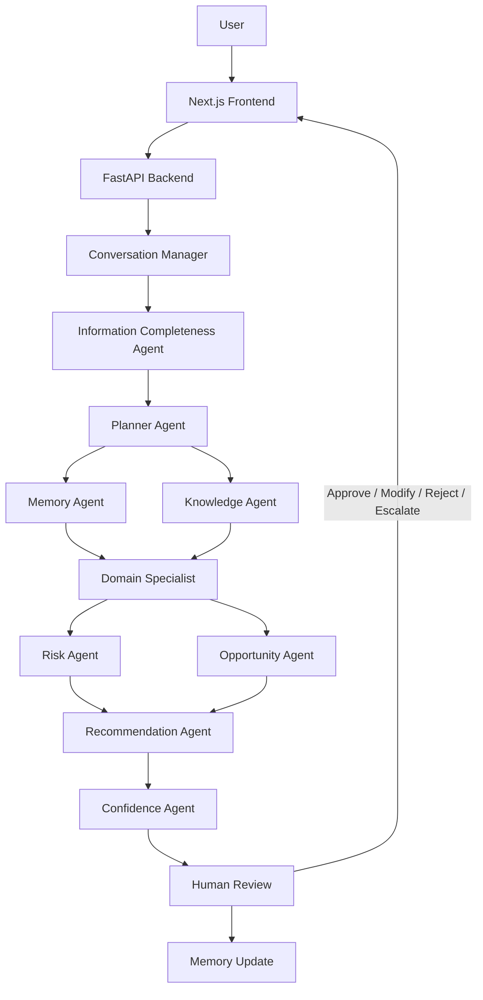

# DecisionOS — Agentic Decision Intelligence Platform

> Turn enterprise context into explainable, actionable decisions with a coordinated multi-agent AI workflow.

**DecisionOS** is an AI-powered decision intelligence platform that accepts business or operational questions, gathers relevant context, coordinates specialized agents, and produces explainable **Next Best Actions (NBAs)**. It is designed to make the reasoning behind a recommendation visible through evidence, risk analysis, confidence information, and human review.

<p align="center">
  <a href="https://github.com/Saipraneeth-12/DecisionOS">GitHub Repository</a>
  ·
  <a href="#getting-started">Getting Started</a>
  ·
  <a href="#architecture">Architecture</a>
</p>

---

## Contents

- [Overview](#overview)
- [Key capabilities](#key-capabilities)
- [Screenshots](#screenshots)
- [Architecture](#architecture)
- [Agent workflow](#agent-workflow)
- [Technology stack](#technology-stack)
- [Repository structure](#repository-structure)
- [Getting started](#getting-started)
- [Configuration](#configuration)
- [Example use cases](#example-use-cases)
- [API and local documentation](#api-and-local-documentation)
- [Evaluation and limitations](#evaluation-and-limitations)
- [Security notes](#security-notes)
- [Team](#team)

---

## Overview

Teams make important decisions using information spread across conversations, documents, customer records, and internal knowledge. When the context and rationale are not brought together, decisions can be difficult to explain, revisit, or improve.

DecisionOS addresses this problem with a structured AI workflow:

1. Understand the user's request and identify its business context.
2. Check whether enough information is available to proceed.
3. Plan the required agent tasks and identify work that can run in parallel.
4. Retrieve relevant organizational memory and document knowledge.
5. Analyze domain-specific risks and opportunities.
6. Generate a recommendation with supporting reasoning.
7. Present the result for human review and approval.

The platform combines a **Next.js frontend** with a **FastAPI backend** and a multi-agent orchestration workflow.

## Key capabilities

- **Multi-agent reasoning:** Specialized agents handle intent, completeness, planning, memory, knowledge retrieval, domain analysis, risk, opportunities, recommendations, and confidence.
- **Parallel execution:** Independent memory and knowledge tasks, as well as risk and opportunity analysis, can be coordinated in parallel by the planner.
- **Retrieval-augmented knowledge:** The knowledge agent is designed to use relevant uploaded documents and enterprise material such as playbooks, policies, contracts, and transcripts.
- **Organizational memory:** Memory components provide a place to retrieve prior context and retain decision-related information across the workflow.
- **Explainable recommendations:** Recommendations are intended to include their supporting evidence, sources, business rules, and relevant memory references.
- **Human-in-the-loop review:** Users can approve, modify, reject, or escalate a proposed action.
- **Streaming interface:** The frontend can display agent execution progress as the workflow runs.
- **Document-oriented workflows:** The backend includes document parsing support for formats such as PDF and DOCX.
- **Multiple business scenarios:** Example scenarios cover customer success, sales, healthcare, energy, staffing, and banking.

> Feature availability depends on the configured model provider, data sources, and runtime configuration. Configure optional services before relying on them in a deployment.

---

## Screenshots

Add screenshots captured from your **own running application** to the `docs/screenshots/` directory. The image paths below are suggested filenames; replace or remove any section for which you do not have a real screenshot.

<!-- Suggested screenshot: docs/screenshots/dashboard.png -->
<!--  -->

### 1. Decision workspace

Show the main application screen where a user enters a business question and reviews the resulting decision.

<!-- Add: docs/screenshots/decision-workspace.png -->

### 2. Agent execution

Show the agent timeline or execution view, including the progress of the specialized agents.

<!-- Add: docs/screenshots/agent-execution.png -->

### 3. Recommendation and review

Show a generated recommendation with its explanation and the human review controls.

<!-- Add: docs/screenshots/recommendation-review.png -->

### 4. Document or knowledge context

Show a real example of the document/context workflow, if enabled in your local configuration.

<!-- Add: docs/screenshots/knowledge-context.png -->

---

## Architecture

DecisionOS separates the user interface, API layer, agent workflow, and supporting services.



### Main components

| Component | Responsibility |
|---|---|
| Frontend | User interaction, conversation interface, agent progress, and decision review |
| FastAPI backend | API endpoints and coordination between application services |
| Agent workflow | Plans and coordinates specialized reasoning tasks |
| Memory layer | Retrieves relevant organizational and prior interaction context |
| Knowledge layer | Retrieves information from supported documents and knowledge sources |
| LLM abstraction | Provides a configurable interface to supported language-model providers |
| Data and infrastructure adapters | Support optional persistence, caching, vector search, and observability integrations |

The repository includes Docker Compose configuration for a full-stack setup. Check the compose file and environment template in the repository before enabling optional infrastructure services.

---

## Agent workflow

The workflow is divided into specialized responsibilities rather than relying on one general-purpose prompt.

| Agent | Responsibility |
|---|---|
| Conversation Manager | Identifies intent, business domain, entities, and urgency |
| Information Completeness Agent | Checks required information, identifies gaps, and reports completeness |
| Planner Agent | Builds the execution plan and determines which tasks can run in parallel |
| Memory Agent | Retrieves organizational memory, similar cases, and relevant history |
| Knowledge Agent | Retrieves relevant information from documents and knowledge sources |
| Domain Specialist | Performs domain-oriented analysis and identifies relevant insights |
| Risk Agent | Evaluates risks, urgency, customer health, and possible escalation |
| Opportunity Agent | Identifies expansion, cross-sell, and other opportunities |
| Recommendation Agent | Produces a proposed Next Best Action with supporting reasoning |
| Confidence Agent | Assesses evidence quality, confidence, and data coverage |

### Typical execution sequence

1. A user submits a business question through the frontend.
2. The Conversation Manager identifies the intent and context.
3. The Information Completeness Agent checks for missing details.
4. The Planner creates an execution graph.
5. Memory and Knowledge agents gather relevant context.
6. The Domain Specialist interprets the available information.
7. Risk and Opportunity agents perform their respective analyses.
8. The Recommendation Agent prepares a proposed Next Best Action.
9. The Confidence Agent assesses the quality of the available evidence.
10. The user reviews the result and decides whether to approve, modify, reject, or escalate it.

---

## Technology stack

| Layer | Technologies |
|---|---|
| Frontend | Next.js 15, React, Tailwind CSS |
| UI and interaction | Framer Motion, Zustand |
| Backend | Python, FastAPI, Pydantic |
| Agent orchestration | LangGraph-inspired multi-agent workflow |
| LLM providers | Gemini, Groq, OpenAI-compatible provider configuration |
| Document processing | PyMuPDF, python-docx |
| API communication | REST APIs, Server-Sent Events (SSE) |
| Optional infrastructure | PostgreSQL, Redis, Qdrant, Langfuse |
| Containerization | Docker, Docker Compose |

**Note:** The repository README describes PostgreSQL, Redis, Qdrant, and Langfuse as optional infrastructure for an expanded deployment. The demo configuration may use in-memory storage and may not require those services. Verify the current backend configuration and `docker-compose.yml` for the exact services enabled by your checkout.

---

## Repository structure

The repository is organized into separate frontend and backend applications.

```text
DecisionOS/
├── backend/
│   ├── app/
│   │   ├── agents/          # Specialized AI agents
│   │   ├── api/
│   │   │   └── routes/      # API routes
│   │   ├── core/            # Configuration, LLM abstraction, logging
│   │   ├── db/              # Database models and database access
│   │   ├── memory/          # Memory management
│   │   ├── services/        # Conversation and document services
│   │   └── workflows/       # Decision orchestration workflow
│   ├── data/
│   │   └── sample/          # Sample data
│   ├── scripts/             # Utility and seed scripts
│   └── requirements.txt
├── frontend/
│   ├── app/                 # Next.js App Router
│   ├── components/
│   │   ├── agents/          # Agent timeline and checklist
│   │   ├── chat/            # Chat interface
│   │   ├── dashboard/       # Dashboard and approval UI
│   │   ├── sidebar/         # Conversation navigation
│   │   └── ui/              # Shared UI components
│   ├── lib/                 # API client, state, and helpers
│   └── package.json
├── docker-compose.yml
├── start.ps1
└── README.md
```

---

## Getting started

### Prerequisites

Install the following before running the project:

- Python 3.12 or later
- Node.js 20 or later
- npm
- Git
- A Gemini API key or Groq API key (depending on the selected LLM provider)
- Docker Desktop, if you plan to use the Docker Compose setup

### 1. Clone the repository

```bash
git clone https://github.com/Saipraneeth-12/DecisionOS.git
cd DecisionOS
```

### 2. Configure the backend

Open a terminal in the backend directory:

```bash
cd backend
```

Create your local environment file from the supplied template:

**Windows PowerShell**
```powershell
Copy-Item .env.example .env
```

**macOS / Linux**
```bash
cp .env.example .env
```

Open `backend/.env` and add the API key for your selected provider. Use the variable names present in the checked-in `.env.example`; do not assume that every provider variable is required.

Install the Python dependencies:

```bash
pip install -r requirements.txt
```

Start the backend:

```bash
uvicorn app.main:app --reload --port 8000
```

The backend should be available at:

- API base: `http://localhost:8000`
- Interactive API documentation: `http://localhost:8000/docs`

### 3. Configure and run the frontend

Open a **second terminal** from the repository root:

```bash
cd frontend
npm install
npm run dev
```

Open the frontend at:

`http://localhost:3000`

Keep both the backend and frontend terminals running while using the application.

### 4. Run with Docker Compose (optional)

The repository includes a `docker-compose.yml` file. Review it and the environment variables it expects before starting the stack.

From the repository root, create and populate the required environment file(s) according to the compose configuration, then run:

```bash
docker compose up --build
```

If your installation uses the legacy Compose command, use `docker-compose up --build`.

---

## Configuration

DecisionOS supports configurable LLM providers. The repository's current README identifies Gemini and Groq as supported choices and also describes an OpenAI-compatible provider option.

Example configuration values:

```env
LLM_PROVIDER=gemini
LLM_MODEL=gemini-1.5-flash
GEMINI_API_KEY=your_gemini_api_key
```

For Groq, configure the corresponding provider and API key using the exact variable names in `backend/.env.example`.

### Obtain an API key

- Google AI Studio: https://aistudio.google.com/
- Groq Console: https://console.groq.com/

**Configuration checklist**

- Select a provider supported by the backend configuration.
- Set the matching API key in the backend environment file.
- Confirm the selected model name is available to your provider account.
- Restart the backend after changing environment variables.
- Never commit `.env` files or API keys to GitHub.

---

## Example use cases

The following prompts illustrate the kinds of business questions that can be explored with the application. They are sample scenarios, not claims about real customer outcomes.

### Customer success — churn risk

```text
We are worried about churn risk for Acme Corp. Their annual contract
renews in 60 days. Platform usage has dropped significantly, our
main customer contact has left, and a competitor is being evaluated.
What should the customer success team do next?
```

### Sales — expansion opportunity

```text
A customer has high feature adoption and positive feedback, and has
recently expanded its engineering team. Identify potential expansion
opportunities and recommend the next action.
```

### Sales — deal acceleration

```text
A large enterprise deal has remained in the final stage for several
weeks. Procurement is delaying progress and a competitor has entered
the evaluation. Identify the main risks and recommend next steps.
```

### Staffing — candidate review

```text
A candidate has strong machine learning and LLM experience but
limited team leadership experience. Evaluate the available evidence
against the requirements of a senior individual-contributor role.
```

---

## API and local documentation

When the backend is running, use FastAPI's interactive documentation:

`http://localhost:8000/docs`

This page exposes the API operations registered by the running backend. The exact routes and request schemas should be taken from the current source code and API documentation rather than assumed from these high-level project descriptions.

---

## Evaluation and limitations

DecisionOS is an AI-assisted decision-support project. Its recommendations depend on the quality of the user input, retrieved documents, configured model, and available context.

Keep the following in mind:

- Model-generated recommendations can be incomplete or incorrect and should be reviewed by a human.
- Confidence indicators should not be interpreted as guarantees of correctness.
- Results may vary between LLM providers and model versions.
- Optional services such as persistent databases, vector search, caching, and observability require their own configuration.
- Do not use generated recommendations as the sole basis for high-impact business, financial, legal, employment, or healthcare decisions.

For a technical evaluation, test the workflow with representative prompts, verify the evidence used by each recommendation, and record latency and quality measurements from your own environment.

---

## Security notes

- Keep API keys and credentials in local environment files or a secrets manager.
- Do not commit `.env` files, tokens, passwords, or private customer documents.
- Use synthetic or anonymized data for demos and screenshots.
- Restrict access to uploaded documents and generated decision records appropriately.
- Review the authentication, authorization, and data-storage configuration before deploying beyond a local development environment.

---

## Team

| Contributor | Area |
|---|---|
| Abhijna Adapa | CSE (Data Science) |
| Sai Praneeth Kummari | CSE (AI & ML) |
| Deepthi | CSE (Data Science) |

---

## Future enhancements

Potential directions for further development include:

- Broader evaluation of recommendation quality and evidence grounding.
- More integrations with enterprise knowledge sources.
- Improved monitoring of agent execution, latency, and model usage.
- Expanded test coverage for agent workflows and failure handling.
- More robust persistence and deployment configurations for production use.

---

## Repository

**GitHub:** https://github.com/Saipraneeth-12/DecisionOS

If you find the project useful, consider starring the repository and sharing feedback.

---

*DecisionOS — From scattered information to explainable next actions.*
